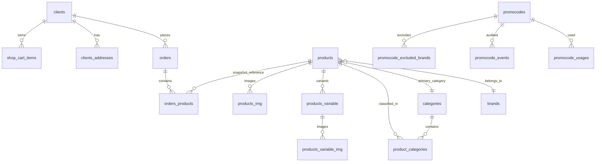
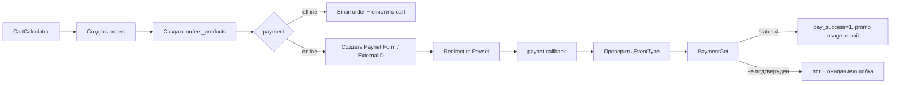

# VIZAJE-NICA Legacy — исследование миграции

Дата аудита: 20.10.2026  
Репозиторий: `vizaje-nica-legacy`, ветка `main`  
Стек Legacy: CodeIgniter 3, PHP 7.4, MySQL, два языка `ru`/`ro`

## Объём и ограничения

Аудит выполнен по текущему локальному рабочему дереву. Код и схема базы данных не изменялись. В рабочем дереве уже находилось 209 изменённых/новых файлов до начала аудита; выводы относятся к этому состоянию, а не к чистому историческому коммиту.

Полного SQL-дампа в репозитории нет. Локальный MySQL во время аудита недоступен, поэтому:

- определения из `database/patches/*.sql` считаются подтверждённой схемой только для добавленных ими объектов;
- остальные поля и связи выведены из моделей, запросов и контроллеров;
- наличие, типы, индексы и реальные значения старых таблиц нужно подтвердить в production-базе перед миграцией;
- production-данные, персональные данные, секреты и значения credentials в отчёт не включены.

Целевой V2-контекст взят из задания: Next.js 16, Bun + Hono, PostgreSQL + Drizzle, Better Auth, Meilisearch, Cloudflare R2. Точная схема V2 в этом рабочем дереве отсутствует, поэтому mapping в разделе 12 является предварительным.

## A. Резюме: 10 самых важных выводов

1. **В Legacy фактически две модели заказа.** Веб-заказ создаётся в `frontend/Cart::checkout()` с `order_source = web`; заказ приложения — в `sapi/Orders::_add()` с `order_source = app`. Оба пишут в `orders`/`orders_products`, но app-flow ставит `client_id = 0`, не переносит бонусное списание и пишет собственный `vsl_logs`.

2. **Баланс лояльности не является локальным ledger.** `clients.Bonus` и `clients.Discount` — снимок, получаемый из WORKAPP/1С по телефону во время входа через телефон. Для получения баланса используется `GetCustomerByPhone`, затем `GetBonusAccum`. Истории бонусных операций в найденной MySQL-модели нет; `orders.bonus_plus`/`bonus_minus` — только снимок начисления/списания конкретного заказа.

3. **Формула бонусов подтверждена кодом.** Начисление: `finalRowTotal * client.discount / 100`, только для B2C-клиента, авторизованного пользователя, товара без обычной скидки и без promo. Списание: не больше локально сохранённого `clients.Bonus` и `bonusEligibleTotal - 1`; сумма округляется вниз до целого MDL. Это не равно автоматически правилам 1С — владелец и правила отмен/возвратов требуют подтверждения.

4. **Каталог, цены и остатки приходят из JSON-выгрузок, совместимых с 1С.** Используются `public/import/products.json`, `pricevn.json`, `JobVN.json`, `old_products.json`. Основной стабильный ключ импорта — `ID_nom`, сохраняемый как `products.GUID`; SKU и варианты обрабатываются отдельно.

5. **Импорт может перезаписывать ручные изменения.** При каждом обычном импорте обновляются названия, описания, инструкции, компоненты, цены, остатки, бренд/категории и SEO-поля из feed. Для части нематериальных отличий есть `product_import_changes`, но это журнал/очередь, а не полноценное правило владения каждым полем.

6. **URL товара — локализованный slug, а не ID.** Маршрут: `/{ru|ro}/{catalog-uri}/{category-uri}/{product-uri}`. PDP ищет `products.uriRU` или `products.uriRO`; fallback по SKU/ID в маршруте не найден. Импорт новых товаров сейчас по умолчанию создаёт URI из `ID_nom`, а отдельный `update_url()` и `Api::url_chech()` могут менять URL. Таблицы redirect history в репозитории не обнаружено.

7. **Paynet считается источником подтверждения онлайн-оплаты, но callback сохраняет сырое тело.** Callback принимает POST, пишет raw payload в `paynet_logs`, проверяет `EventType = PAID`, затем перепроверяет платёж через `PaymentGet` и ждёт статуса `4`. Нужно отдельно проверить подпись/аутентификацию webhook и retention логов.

8. **1С order export защищён слабой legacy-механикой.** `api/order_json` отдаёт все заказы с `orders.1c = 0`; `api/order_check` помечает заказ `1c = 1`. В контроллере присутствует статическая авторизация, зашитая в исходник. Значения намеренно не приводятся; перед V2 нужно заменить это на отдельную интеграцию с секретом из окружения, TLS, idempotency и журналом попыток.

9. **Privacy-функции частично реализованы в текущем дереве.** Есть `consent_events`, `personal_data_requests`, форма в личном кабинете и отправка запроса на служебный email. Но запрос помечается `identity_verified = 1` без видимой дополнительной верификации, автоматическая выгрузка/исправление/удаление не реализованы, а локальная запись и email не имеют общей гарантированной транзакции.

10. **До миграции нельзя переносить клиентов и бонусы “как обычные поля”.** Нужны reconciliation с 1С по телефону, таблица external identity, отдельный бонусный ledger или подтверждённый online-read через 1С, политика дублей/неактивных клиентов, исторические URL redirects и идемпотентный order/payment/inventory sync.

## B. Матрица источников истины

| Данные | Что видно в Legacy | Предварительный владелец | Доказательство | Что подтвердить |
|---|---|---|---|---|
| Клиентский профиль | `clients`: имя, фамилия, email, телефон, адрес, активность, подписки | Смешанная модель: сайт хранит профиль, 1С получает базовые поля по телефону | `application/models/Clients_model.php`; `application/controllers/frontend/Account.php::workappPost()` | Какая система может менять имя/телефон/email; правила дублей |
| Идентичность магазина/app/web | сайт использует `clients.id`; app order ставит `client_id=0`; Firebase содержит phone auth | Не подтверждён единый master identity | `application/controllers/sapi/Orders.php::_add()`; `application/libraries/FirebaseLib.php` | Связывает ли приложение Firebase UID с `clients.id` или с 1С-клиентом |
| Discount/Bonus | `clients.Discount`, `clients.Bonus` обновляются из WORKAPP | Вероятно 1С | `Account::workappGet()` | Условия начисления, списания, возвратов и срок действия в 1С |
| Товар | `products` и `products_variable` | 1С/feed для core-полей; сайт для ручного контента и изображений | `application/controllers/Import.php::import()`/`import_variable()` | Полный контракт feed, удаление/архивирование отсутствующих товаров |
| Цена | `products.price`, `priceWH`, `discount_price`, `products_variable.price`, `priceWH` | Feed/1С плюс локальные promo/discount | `Import::update_price()`, `CartCalculator` | Какая цена считается официальной при конфликте |
| Остаток | `on_stock`, `on_stockWH`, `products_variable.qty`, `qtyWH` | Feed/1С | `Import::import()`, `Import::import_variable()`, `update_stock()` | Значение каждого `Bal*`, резервы и офлайн-продажи |
| Изображения | `products_img`, `products_variable_img`, файлы в `public/*` | Похоже на локальный back-office/медиа-процесс | `backend/Products.php`, `newthumbs()` | Где физически хранится master, правила удаления и права использования |
| Заказ | `orders`, `orders_products` | Legacy-сайт создаёт заказ; 1С получает через pull API | `frontend/Cart.php`, `Api::order_json()`, `sapi/Orders.php` | Ack/status/refund из 1С, retry и ownership статуса |
| Онлайн-платёж | `ExternalID`, `pay_success`, Paynet callback | Paynet для факта оплаты; сайт для order record | `Paynet::paynet_callback()` | Официальный webhook contract, подпись, refunds/chargebacks |
| Промокоды | `promocodes` и usage/event/brand tables | Legacy MySQL | `application/models/Promocodes_model.php`, `CartCalculator` | Нужна ли миграция всей истории usage |
| Контент/SEO | `menu`, `articles`, `brands`, `categories`, SEO-поля | Legacy CMS/back-office | соответствующие модели и backend controllers | Что переносится в CMS, что в Git/seed |
| Юридические согласия | `consent_events`, cookie `cookie_consent` | Legacy web application | `FrontEndController`, `Ajax`, privacy patch | Retention, версия текста, legal basis и mobile scope |

## C. Инвентаризация Legacy-схемы

### C.1 Подтверждено SQL-патчами

В репозитории есть только incremental patches, не исходная полная схема.

| Объект | Подтверждённые поля/ограничения | Файл |
|---|---|---|
| `orders.order_source` | `VARCHAR(16) NOT NULL DEFAULT 'unknown'`; добавляется после `id` | `database/patches/2026-09-30-add-orders-source.sql` |
| `product_import_changes` | `id` PK; `product_id`, `product_guid`, `action`, `changed_fields`, `created_at`; индексы по created/product/action | `database/patches/2026-09-30-add-product-import-changes.sql` |
| `product_import_changes` review | `status`, `reviewed_at`, индекс status | `database/patches/2026-10-01-track-product-import-review.sql` |
| `products.seo_indexable` | nullable `TINYINT(1)`; `NULL` означает автоматическое правило, `0/1` — override | `database/patches/2026-10-02-add-product-seo-index-control.sql` |
| `products.youtube_video_id` | nullable `VARCHAR(11)` | `database/patches/2026-10-02-add-product-youtube-video.sql` |
| `articles` extensions | `isBlog`, `tagsRU`, `tagsRO`; `article_likes` с уникальностью `(article_id, visitor_key)` | `database/patches/2026-10-07-add-blog-fields.sql` |
| `offers.is_online` | `TINYINT(1) NOT NULL DEFAULT 1` | `database/patches/2026-10-07-add-offer-online-flag.sql` |
| `clients` welcome offer | `welcome_offer_started_at`, `welcome_offer_expires_at` | `database/patches/2026-10-12-add-welcome-offer.sql` |
| `roulette_*` | admin settings/prizes; account state; spins; payment reservations; unique request/external Paynet IDs | `database/patches/2026-10-16-create-roulette-admin-settings.sql`, `2026-10-16-roulette-gameplay-v1.sql` |
| `consent_events` | `client_id`, `channel`, `consent_value`, `source`, `content`, `email`, `phone`, `created_at`; индексы client/channel и created_at | `database/patches/2026-10-19-privacy-site-controls.sql` |
| `personal_data_requests` | `client_id`, `request_type`, `details`, `source`, `status`, `identity_verified`, `admin_note`, created/updated/processed timestamps; индексы client/status и created_at | `database/patches/2026-10-19-privacy-site-controls.sql` |
| privacy menu copy | обновляет `menu.id = 23`, добавляет ориентир ответа до одного месяца | `database/patches/2026-10-19-privacy-response-deadline.sql` |

### C.2 Таблицы, выведенные из моделей и запросов

Типы и полные ограничения ниже не подтверждены дампом; перед миграцией нужно выполнить `SHOW CREATE TABLE` в production.

| Таблица | Ключи/связи, видимые из кода | Основные поля и смысл |
|---|---|---|
| `clients` | `id` используется как PK и как ссылка из заказов/корзины/consent | `name`, `surname`, `email`, `phone`, `password`, `active`, `code`, `Discount`, `Bonus`, `address`, `isb2b`, `mail_subscribe`, `sms_subscribe`, welcome offer fields |
| `clients_addresses` | `client_id` | модель читает одну запись через `row()`; список полей и запись в найденном коде не подтверждены |
| `products` | `id`; `brand_id`, `category_id`; `GUID` — внешний feed key | `SKU`, localized title/desc/text/instruction/components/URI/SEO, `price`, `priceWH`, `discount_price`, `sale_percent`, `barcode`, `volume`, `sex`, `on_stock`, `on_stockWH`, `isShown`, `is_new`, `best_selling`, `variations`, `WarehouseName` |
| `products_variable` | `id`; `product_id` → parent product | `SKU`, localized title/color, `price`, `priceWH`, `discount_price`, `qty`, `qtyWH`, `barcode`, `VolumeVar`, `WarehouseName`, `isShown` |
| `product_categories` | `product_id`, `category_id` | junction table; при этом `products.category_id` также используется, то есть в Legacy есть dual category model |
| `products_img` | `product_id`; `id` | `img`, `sorder`; первая картинка по `sorder ASC, id DESC` используется как primary |
| `products_variable_img` | `variable_id` | `img`, `sorder`; применяется для изображений вариантов |
| `brands` | `id`; product `brand_id` | `title`, `uri`, `img`, `isShown`, `sorder`, localized h1/text/SEO; `GUID` используется импортом как дополнительный count/marker |
| `categories` | `id`; `parent_id` hierarchy | `title*`, `uri*`, `step`, `isShown`, `sorder`, `top_menu`, `feature_type`, image fields, localized H1/breadcrumb/SEO |
| `category_banner` | `category_id` | localized title/description/URI, `img` |
| `collections` | `brand_id` | brand collection relation; точная модель коллекции требует DB verification |
| `stores` | `id` | `coords`, localized title/desc/text, `phone`, `isShown`, `onBottom`, `delivery` |
| `stores_img` | `stores_id` | `img`, `sorder` inferred from controllers |
| `delivery` | no FK shown | localized title/description/note/text blocks for several delivery types; `isShown` |
| `orders` | `id`; `client_id`; `order_id` public number; `ExternalID` Paynet; `stores` likely store id | customer snapshot, `total`, `delivery_price`, `delivery`, `payment`, `status`, `bonus_plus`, `bonus_minus`, promo/voucher fields, `pay_success`, `1c`, `isb2b`, `ip`, timestamps, `order_source` |
| `orders_products` | `order_id`, `product_id`, `options` → variant id | `qty`, `price`, `promo_discount`, `total`; does not visibly store a complete immutable product-name/SKU snapshot |
| `shop_cart_items` | `id`; `code`; `contact_id`; `product_id`; `sku_id` | server-side cart linked to 7-day `shopcart` cookie; `options` JSON; quantity/price/name/timestamp |
| `wishlist_items` | `contact_id`, `product_id` | authenticated wishlist table; guest wishlist also uses cookie in frontend |
| `promocodes` | `id`; usage references `promocode_id` | code, type/value, limits, dates, status, `allow_discounted`, `brand_scope` |
| `promocode_usages` | `promocode_id`, client/order references | usage count and per-user limit checks |
| `promocode_events` | `promocode_id`, client/order references | audit events such as order-created; exact columns from code |
| `promocode_brands` / `promocode_excluded_brands` | promo ↔ brand | inclusion/exclusion rules |
| `menu` | `id`; localized URI/content | pages, navigation, legal text, `isShown`, SEO and page content |
| `articles` | `id` | news/blog content, localized URI/SEO, images, `isBlog`, tags, publication date |
| `article_likes` | PK `id`; unique `(article_id, visitor_key)` confirmed by patch | one like per browser/session key |
| `sliders`, `banners` | `id` | homepage/advertising media and localized content; exact columns from models/views |
| `home_categories`, `home_product_items`, `home_brand_sections` | section/product/category references | manually managed home merchandising and placement |
| `paynet_logs` | no schema dump | callback/request diagnostic payloads and timestamps; may contain payment/customer data |
| `analytics_events` | `event_uid`, visitor/session/cart/product/category/order dimensions | local analytics events stored only when analytics consent exists |
| `site_feedback`, `site_feedback_images` | feedback id references | public idea/bug feedback, optional up to three image uploads |
| `vsl_log` / `vsl_logs` | no schema dump | Firebase error phone logging and app order request logging; retention unknown |

### C.3 Relationship diagram

Foreign keys and `ON DELETE` rules are not visible in the repository; the diagram is logical, not a verified InnoDB constraint graph.

## 1. Клиенты и авторизация

### Фактические сценарии

1. **Email registration.** `application/controllers/frontend/Account.php::registration()` принимает email/password, проверяет существующий email через `Clients_model::check_email()`, сохраняет пароль как SHA-1, отправляет activation link через `ilabCrypt`, а затем вызывает `workappPost()` с телефоном/именем/датой рождения.

2. **Phone + email registration.** `Account::registration_form()` требует email и номер телефона, проверяет email и phone в `clients`, создаёт `clients` с `active = 1`, random/entered password, numeric `code`, затем отправляет SMS-код. `login_form_code()` проверяет телефон + `clients.code`, после чего меняет `code` на `1`.

3. **Login.** Email/password и phone/password используют `Clients_model::login()` и SHA-1. Phone one-time code использует `login_code()`. Сессия хранит `user_id`, `user_login`, `usr_key`, `isb2b`; `FrontEndController::_is_logged_in()` повторно получает клиента из БД.

4. **Password recovery.** Email recovery генерирует ссылку `password_reset?token=...`, после чего новый пароль снова сохраняется как SHA-1.

5. **Guest checkout.** `frontend/Cart::checkout()` при отсутствии сессии устанавливает `client_id = 0`; имя, email, телефон и адрес сохраняются непосредственно в заказе.

6. **Profile changes.** Личный кабинет обновляет профиль через `clients_model->update()` и передаёт отдельные изменения в `workappPost()`. Явный write-path для `clients_addresses` в найденном коде отсутствует; есть только `Clients_model::get_address()`.

7. **Social auth.** Google/Apple OAuth в Legacy не найден. Firebase library умеет Firebase Auth по номеру телефона и custom tokens, но mapping Firebase UID → local client/1C ID в найденном коде не подтверждён.

### Критичные замечания для V2

- Не переносить SHA-1 в Better Auth без отдельной стратегии совместимости и обязательного сброса/миграции пароля.
- Уникальность email/phone проверяется приложением (`check_email`, `check_number`), но DB unique constraints без production `SHOW CREATE TABLE` не подтверждены.
- `clients.code` используется одновременно как active/filter marker и как временный SMS-code. В V2 это должны быть отдельные поля/таблицы OTP с expiry, attempt counter и one-time consumption.
- Нельзя считать `client_id = 0` доказательством, что app-заказ был гостевым: app controller всегда ставит `0`, даже если клиентская идентичность могла существовать в Firebase/1С.
- Для привязки старых заказов нужны phone normalization, email fallback, ручная очередь конфликтов и запрет автоматического объединения при совпадении только одного слабого атрибута.

## 2. Бонусы и лояльность

### Подтверждённая реализация

`application/libraries/CartCalculator.php` строит checkout state:

- `bonus_eligible = true`, только если B2C, клиент авторизован, у строки нет обычной скидки и нет promo discount;
- `bonusEligibleTotal` — сумма `final_total` eligible-строк;
- начисление строки: `rowBonus = finalRowTotal * client.discount / 100`;
- `bonusTotal` — сумма таких строк;
- баланс берётся из `client.Bonus`;
- максимум списания: `floor(min(client.Bonus, max(0, bonusEligibleTotal - 1)))`.

`frontend/Cart::checkout()` повторно проверяет сумму на сервере, принимает `bonus_amount`, ограничивает её `bonus_max_writeoff`, запрещает начисление бонусов в заказе, где бонусы списываются, и сохраняет `orders.bonus_plus`/`orders.bonus_minus`. Для Paynet `applyBonusToPaynetItems()` распределяет скидку по eligible-строкам в центах/банях и оставляет минимум 0.01 MDL на каждой line, а минимум 1 MDL — на всём eligible subtotal.

### Что не найдено

- локального bonus transaction ledger;
- даты истечения отдельных бонусов;
- уровней loyalty;
- отдельных рекламных и обычных bonus wallets;
- реализации начисления/списания в физическом магазине;
- подтверждённого вызова 1С для списания/резерва бонусов;
- обработки бонусов при отмене/возврате;
- мобильного endpoint баланса в этом репозитории.

### Риски

1. **Stale snapshot:** `clients.Bonus` обновляется при определённых login flows, поэтому checkout может использовать устаревший баланс.
2. **Double spend:** два параллельных checkout могут увидеть один и тот же баланс; локальной блокировки или reservation в `clients` для бонусов не найдено.
3. **Payment race:** веб-заказ и Paynet callback разделены; неизвестно, когда и где 1С фактически списывает бонусы.
4. **Returns:** без ledger и confirmed 1С contract невозможно воспроизвести возврат бонусов корректно.

### Решение для миграции

До миграции выбрать один из вариантов и зафиксировать его с владельцем 1С:

- 1С — единственный ledger; V2 получает authoritative balance и отправляет idempotent redemption/earn operations;
- V2 — ledger; 1С принимает события и возвращает подтверждение;
- transitional model: V2 хранит immutable snapshot/operations, но не обещает баланс authoritative до reconciliation.

Простое копирование `clients.Bonus` в `loyalty_balance` без даты снимка, source и reconciliation недопустимо.

## 3. Интеграция с 1С и импорт

### Feed-файлы

Файлы реально присутствуют:

- `public/import/products.json` — массив записей; есть `ID_nom`, `WarehouseName`, barcode, localized descriptions/instructions/components/SEO, category hierarchy, `VariativeNomenclature`, variant names, quantity fields `QuantityBalance`/`Bal*`, `Price`, `PriceWH`.
- `public/import/pricevn.json` — `ID_nom`, `DiscountPrice`, `VariativeNomenclature`, `Price`.
- `public/import/JobVN.json` — структура похожа на products feed, включая SEO-поля; используется `Import::update_seo()`.
- `public/import/old_products.json` — исторический/резервный feed, отдельного runtime consumer в проверенных путях не подтверждено.
- `products.json` в корне — отдельный локальный JSON-файл; `Import` использует `public/import/products.json`, не корневой файл.

В JSON нет обнаруженного общего `version`, `exported_at` или cursor field; время/версию можно получить только из filesystem metadata, а не из record contract.

### Import mapping и поведение

`application/controllers/Import.php::import()`:

- строит in-memory maps существующих `products` по `GUID`, категорий и брендов;
- пропускает записи без `ShortDescriptionRus`;
- выбирает SKU как `VariativeNomenclature`, если он есть, иначе `ID_nom`;
- новый product получает `GUID = ID_nom`, core fields, `on_stock = QuantityBalance + BalMall`, `on_stockWH = QuantityBalance` и URI из `ID_nom`;
- пишет parent `category_id` и junction rows `product_categories`;
- существующий product обновляет цены, stock, localized content, instructions, components и SEO-поля;
- категории в junction перед обновлением удаляются и вставляются заново;
- новые и изменённые non-price поля могут записываться в `product_import_changes`.

`Import::import_variable()` сопоставляет существующий variant по `products_variable.SKU = ID_nom`, ищет parent product по SKU `VariativeNomenclature`, сохраняет `product_id`, `qty = QuantityBalance + BalMall`, `qtyWH = QuantityBalance`, цены, цвет, volume и barcode.

Другие методы:

- `update_price()` — `public/import/pricevn.json`, обновляет `products.price/discount_price` и цены вариантов;
- `update_seo()` — `JobVN.json`, обновляет SEO title/description;
- `update_qty()` — пересчитывает агрегаты по вариантам;
- `update_stock()` — пересчитывает `on_stock`/`on_stockWH`;
- `update_url()` — исправляет дубли, добавляя `-id`;
- `update_sale_mdl()` — рассчитывает sale amount/percentage;
- `update_search_tag()` — добавляет данные вариантов для поиска.

### Заказы в 1С

`application/controllers/Api.php::order_json()`:

- выбирает `orders` с `1c = 0`;
- возвращает public `order_id`, status, total, delivery, customer snapshot, address и позиции;
- для позиции отдаёт product id, quantity, price, options и SKU; variant SKU разрешается через `products_variable`;
- `order_check()` по public `order_id` меняет `orders.1c = 1` и возвращает order payload.

Это pull/ack-модель. Retry, lock/lease и atomic claim не видны. При параллельных запросах возможна повторная выдача одного заказа до ack. Проверка production-клиента 1С и фактической периодичности вызовов обязательна.

### Customer sync с WORKAPP

`Account::workappPost()` отправляет по телефону имя, фамилию и дату рождения в `PostCustomerInfoByPhone`. `Account::workappGet()` пробует номер в формате без `+`, затем fallback через `0`, получает `Discount` и `Code`, после чего вызывает `GetBonusAccum/{Code}` и обновляет local `clients.Discount`, `clients.Bonus`, name/surname.

Интеграция сейчас использует HTTP URL на нестандартном порту, а не HTTPS. Это критичный blocker для V2 и для текущего security review.

### Неизвестно

- расписание запуска import routes;
- что делает 1С с заказом после `order_check`;
- возвращает ли 1С изменения статуса/остатков push-методом;
- как кодируется отмена, возврат и частичная отгрузка;
- что означает каждый `Bal*` и `WarehouseName`;
- как обрабатывается товар, исчезнувший из feed;
- является ли `ID_nom` стабильным навсегда;
- есть ли отдельный production integration gateway, отличный от URL в коде.

## 4. Каталог, категории, бренды и остатки

### Товары и варианты

Parent product живёт в `products`; вариант — в `products_variable`. Parent может иметь нулевую собственную цену, если существует доступный вариант с ценой и остатком: `Products_model::applySellableCondition()` проверяет `products.price` или `EXISTS products_variable(price > 0, qty > 0)`, отдельно для B2C/B2B.

Вариант в корзине хранится как `options = variable_id`; при заказе это значение сохраняется в `orders_products.options`. SKU, barcode, color, volume и warehouse name есть и у parent, и у variant.

### Категории

`categories` — иерархия через `parent_id`/`step`. В основном listing используется `products.category_id`, но import дополнительно поддерживает `product_categories`, включая две входные категории. Нужно решить, переносится ли V2 multi-category relationship или только primary category.

### Бренды

`brands.uri` общий для языков; `brands.title` не локализован в основной модели, но SEO/H1/text локализованы. Бренд URL: `/{lang}/{catalog-uri}/{brand.uri}`. Если бренд не найден, `Catalog::brands()` делает 301 на catalog root; это отдельное поведение от product 404.

### Статусы и merchandising

Видимые flags: `isShown`, `is_new`, `best_selling`, `sale_percent`, `discount_price`, `sorder`. Домашние секции также управляются таблицами `home_product_items`, `home_brand_sections`, `home_categories`; это не полностью выводится из product flags. Рекомендации — `products_related`/`products_more` и похожие товары в `Products_model`.

### Остатки и магазины

`stores` содержит пункты/магазины, координаты, контакты, описание и флаг `delivery`. В checkout:

- `delivery = 1` — самовывоз, `orders.stores` хранит выбранный магазин, адрес очищается;
- `delivery = 2` — обычная курьерская доставка, цена зависит от `FREE_SHIPPING_VALUE`;
- `delivery = 3` — express, фиксированная цена 100 MDL;
- на стороне app те же значения используются в `sapi/Orders`.

Отдельная таблица online reservations или stock-by-store в найденном коде не обнаружена. `on_stock`/`qty` выглядят как агрегаты, а `WarehouseName` — feed metadata. Нельзя утверждать, что `BalMall` — конкретный магазин выполнения заказа, пока это не подтверждено у 1С.

## 5. Checkout, заказы и платежи

### Поля заказа

Web checkout сохраняет snapshot в `orders`:

`status`, `order_source`, random public `order_id` из диапазона 10000–99999, `total`, `delivery_price`, `promo_id`, `promo_code`, `promo_discount`, `client_id`, `name`, `surname`, `email`, `phone`, `message`, `payment`, `stores`, `delivery`, `bonus_plus`, `bonus_minus`, `address`, `ip`, `voucher`, `added`, `isb2b`.

`orders_products` сохраняет `order_id`, `product_id`, `qty`, unit `price` после обычной скидки, `options` variant id, `promo_discount`, final `total`. Полный SKU/title snapshot в таблице позиции не найден; при миграции нужно сохранить исторические display fields отдельно, иначе изменения каталога изменят старые заказы.

### Delivery/payment

Web поддерживает pickup, courier, express; payment codes по legacy mapping: cash, card to courier/terminal и online Paynet. App flow считает total из входных product prices, пишет `order_source = app`, логирует payload в `vsl_logs` и для online payment вызывает Paynet.

### Paynet lifecycle

Callback не должен считать только входной `PAID` достаточным: код дополнительно вызывает `PaymentGet`. Но в callback найдено сохранение raw JSON в `paynet_logs`, а защита от повторной обработки и формальная signature verification неочевидны. Это нужно покрыть idempotency key `ExternalID`, уникальным индексом и тестами повторного webhook.

Refund, chargeback и полноценная отмена оплаты в найденном checkout flow не реализованы. Отмена заказа как административное изменение статуса есть в back-office, но связь с Paynet refund и бонусной компенсацией не подтверждена.

## 6. Медиафайлы

### Директории

В репозитории реально присутствуют `public/products`, `products_variable_img`, `brands`, `categories`, `category_banner`, `stores`, `stores_img` (через DB), `banners`, `sliders`, `articles`, `offers`, `menu`, `home_categories`, `home_brand_sections`, `brand_certificates`, `i`, `barcode`, `orders`, `clients` и `import`.

`newthumbs()` в `application/helpers/mine_helper.php` формирует URL вида `/public/{dir}/{file}`, а для некоторых `products`/`sliders` сначала создаёт WebP. Для обычных изображений используется `phpThumb`, каталог `thumbs/version_{version}` и fallback `/public/i/no_image_*`. В базе хранятся имена/относительные пути, не полный CDN URL.

Для product gallery порядок берётся из `products_img.sorder ASC, id DESC`; для variant gallery — `products_variable_img.sorder`. Backend uploads в `public/products` и `public/products_variable_img` создают/обновляют соответствующие DB rows.

### План R2 mapping

1. Сначала выгрузить DB media rows и построить immutable map `legacy_table + row_id + stored_name → r2_object_key`.
2. Сохранить public legacy path/URL в migration table до смены CDN.
3. Ключи R2 строить детерминированно: `products/{product_id}/{image_id}-{safe-filename}`, `variants/{variant_id}/{image_id}-{safe-filename}`, отдельно `brands`, `categories`, `articles`, `banners`.
4. Не переименовывать физические объекты без redirect/alias map: старые OG/feed/email URL могут ссылаться непосредственно на `/public/...`.
5. Проверить orphan files и files with no DB row отдельным report; не удалять их до production backup и периода наблюдения.

## 7. SEO, URL и индексация

### Форматы

- Home: `/{lang}`.
- Catalog root: `/{lang}/{catalog-uri}`.
- Category: `/{lang}/{catalog-uri}/{category-uri}`.
- Product: `/{lang}/{catalog-uri}/{category-uri}/{product-uri}`.
- Brand: `/{lang}/{catalog-uri}/{brand.uri}`.
- Blog: `/{lang}/blog/{article-uri}`.
- RU/RO имеют разные localized page/category/product URI; brand URI общий.

`routes.php` lines 149–153 задают catalog routing. `Catalog::item()` сначала разрешает категорию по `categories.uri{lang}`, затем product строго по `products.uri{lang}` и `isShown = 1`. Out-of-stock PDP остаётся доступным, если опубликован; sellability нужна для listing/cart, но не для PDP.

### Slug и URL risk

`Import::import()` для нового товара создаёт `uriRU/uriRO/uriEN` из `ID_nom`. `Import::update_url()` и `Api::url_chech()` могут менять дублирующиеся URI: один путь добавляет `-id`, другой пытается использовать transliterated title + SKU. Поэтому разные товары в базе могли исторически получить URI из разных алгоритмов.

Redirect map по старым URI в найденной схеме/коде не обнаружен. Это объясняет SEO-риск: любое изменение `uriRU`/`uriRO` делает старую проиндексированную ссылку 404, если веб-сервер/приложение не знает старый slug.

### Canonical/hreflang/sitemap

`Catalog::prepareProductUrls()` строит canonical и hreflang из текущих page/category/product URI. `Catalog::category()` и listing pages ставят `noindex,follow` для filter/sort combinations, а pagination получает canonical с `?page=`.

`mine_helper`/`Pages::sitemapGenerator()` пишет `/sitemap.xml`, добавляет homepage, menu pages, categories, brands, blog posts и product URLs. Для products используются `isShown`, published category, image existence и `Products_model::isSeoIndexable()`; stock не проверяется. `robots.txt` в репозитории есть, но перед production миграцией нужно проверить его содержимое и sitemap host.

### Безопасная миграция URL

1. До импорта сохранить по каждому product id/GUID/SKU обе текущие URI и category paths.
2. В V2 завести `legacy_urls`/`redirects` с unique old URL, target entity, status code, created/replaced timestamps.
3. Разрешать старый product URL по сохранённому map и отдавать 301 на canonical, не 404.
4. Новый slug менять только через explicit redirect transaction.
5. Не заменять SEO URL на numeric SKU/ID, если цель — сохранить индексацию; SKU можно оставить lookup alias, но не canonical.
6. После cutover сравнить sitemap, canonical, hreflang, Google Search Console crawl errors и server logs.

## 8. Дополнительные функции и контент

| Функция | Legacy evidence | Приоритет V2 |
|---|---|---|
| Catalog/products/variants | products, products_variable, filters, search | Критично |
| Cart/checkout/orders | Cart, MY_Cart, Orders | Критично |
| Paynet | Paynet controllers/SDK/callback | Критично для online payment |
| 1С catalog/stock/order sync | Import, Api, WORKAPP | Критично |
| Customer account/phone auth | Account, Clients_model, FirebaseLib | Критично |
| Loyalty/bonus | clients.Bonus/Discount + CartCalculator | Критично, но контракт 1С не закрыт |
| Promo/coupons | Promocodes_model, CartCalculator | Высоко |
| Delivery/pickup/stores | stores, delivery, checkout | Критично |
| Gift certificates | Certificat, app DB `gift_cards*`, Paynet | Высоко |
| Wishlist | Wishlist, `wishlist_items`, cookie | Средне/высоко |
| Brands/categories/SEO | models, catalog, sitemap | Критично для organic traffic |
| Homepage merchandising | sliders, banners, home sections | Высоко |
| Blog/news | articles, `isBlog`, tags, likes | Средне |
| B2B | session `isb2b`, priceWH/qtyWH, B2B controller | Открыть до запуска, если канал активен |
| Contact/store pages | Pages, stores, contact email | Средне |
| Email/SMS/push | Email library, sendSMS, Firebase | Высоко |
| Privacy/cookie consent | consent cookie, consent_events, requests | Критично юридически |
| Roulette/welcome offer | patches, models, checkout integration | После базовой миграции, но не потерять active rewards |
| Admin/back-office | `backend/*`, `BackEndController` | Критично для operations, даже если новый UI позже |

## 9. Безопасность и приватность

### Подтверждённые риски

- Customer passwords используют SHA-1: `Account.php` и `Clients_model.php`. Это не подходящий формат для Better Auth password verification без специальной миграции.
- Phone OTP использует одно поле `clients.code`; expiry, attempts и rate limit в найденном flow не видны.
- Admin passwords используют SHA-256 без индивидуальной password hashing scheme: `application/models/Admins_model.php::try_login()`.
- `Api::order_json()`/`order_check()` используют статическую авторизацию в исходном коде. Значения не приводятся в отчёте.
- Import endpoints перечислены прямо в `routes.php`, а `Import` constructor не показывает auth check. Нужно немедленно проверить production access control; если web-reachable, импорт может быть вызван извне.
- WORKAPP URL в `Account`, `Paynet`, `Certificat` использует HTTP, а не HTTPS.
- SMS request в `Account::sendSMS()` отключает TLS peer/host verification. Credentials находятся в исходнике; их нельзя оставлять там.
- Firebase service account читается из `application/libraries/secret/...json`. Нужно проверить, tracked ли файл, filesystem permissions и rotation. Ошибки Firebase пишут номер телефона в `vsl_log`.
- Paynet callback сохраняет raw payment payload в `paynet_logs`; retention/redaction не видны. Нельзя логировать полные персональные/платёжные payloads без политики.
- `FrontEndController` добавляет security headers, cookie config в `config.php` включает HttpOnly/SameSite и HTTPS-aware Secure, но production proxy/HTTPS поведение нужно проверить. В динамическом frontend встречается `Cache-Control: max-age=31536000`; нельзя кэшировать персонализированные HTML/checkout/session responses так долго.
- CSRF-защита в отдельных POST endpoints не подтверждена единообразно: есть ручная `check_if_POST()`, но нужен endpoint-by-endpoint audit.

### Privacy/cookies

`FrontEndController::_read_cookie_consent()` читает JSON cookie `cookie_consent` с каналами `functional`, `analytics`, `marketing`; necessary assumed true. `Ajax::cookie_consent` и `record_consent_event()` поддерживают выбор пользователя.

В `application/views/pages/index.php` есть Google Consent Mode, Meta Pixel, GTM/analytics и Ahrefs-related tags, условно подключаемые по consent. Однако одного статического чтения недостаточно: нужно в браузере проверить first request, отказ/изменение решения, cookies, network requests и event payloads, включая отсутствие email/phone в analytics URLs.

`Analytics::event()` принимает только allowlisted event names, visitor/session keys и ограниченные attribution fields, сохраняет в `analytics_events` только при analytics consent. Это лучше, чем unrestricted event endpoint, но нужен production network audit.

`Account::index()` поддерживает `access`, `correction`, `erasure`, `restriction`, `objection`; пишет `personal_data_requests`, отправляет письмо на адрес из `PERSONAL_DATA_REQUEST_EMAIL`, а маркетинговые переключатели пишет в `consent_events`. Верификация личности помечается `1` для авторизованного кабинета, но отдельный процесс для email/phone request, admin review, legal retention exceptions и export archive не найден.

## 10. Предварительный mapping Legacy → V2

| Legacy entity/fields | V2 candidate | Преобразование | Риск |
|---|---|---|---|
| `clients.id`, name, surname, email, phone, active | Better Auth user + customer profile | создать stable `legacyClientId`; normalize phone E.164; dedupe queue | Высокий: дубли и неясный external 1C identity |
| `clients.password` SHA-1 | Better Auth account | не переносить как обычный hash; force reset или verified compatibility bridge | Критический |
| `clients.code`, SMS flow | OTP/session tables | отделить one-time code, expiry, attempts, consumed_at | Критический |
| `clients.Discount`, `Bonus` | loyalty account/snapshot or external balance | сохранить source=`1c`, observed_at, external customer key; потом reconcile | Критический |
| `clients_addresses` + order address | addresses + order address snapshot | не менять старые order addresses; определить multiple/default | Высокий |
| `products.GUID`, SKU, localized content | product + external keys + translations | `GUID` → legacy integration key; keep SKU/barcode aliases | Критический |
| `products_variable` | product variants | parent mapping via `product_id`/feed `VariativeNomenclature` | Высокий |
| `products.price/discount_price`, variants prices | price list/price rules | define effective price and currency; preserve historical order prices | Критический |
| `on_stock`, variant qty, `WarehouseName` | inventory locations/balances | map every `Bal*` only after 1С dictionary; no invented store mapping | Критический |
| `categories.parent_id`, `product_categories` | category tree + product-category join | preserve primary and secondary memberships | Высокий |
| `brands.uri`, localized SEO | brands + slugs + translations | brand URI remains stable alias/canonical | Высокий |
| `products_img`, `products_variable_img` | R2 media + product media | copy bytes; preserve order, alt/source and legacy URL map | Высокий |
| `orders` | orders | map public `order_id` separately from V2 UUID; keep source/status/payment IDs | Критический |
| `orders_products` | order items | snapshot title/SKU/price/discount/variant at migration time | Критический |
| `orders.1c` | integration delivery/ack state | replace boolean with attempts, claimed_at, external id, last error | Критический |
| `orders.ExternalID`, `pay_success` | payment attempts/transactions | one-to-many payment attempts, idempotent webhook state | Критический |
| `bonus_plus/minus` | loyalty transactions/order adjustments | not enough for ledger; import as historical adjustment/snapshot only | Критический |
| `promocodes*` | campaigns/coupons/redemptions | preserve code/limits/date/brand scopes and usage order | Высокий |
| `stores`, `delivery` | fulfillment locations/delivery methods | normalize localized content and delivery rules | Высокий |
| `menu`, `articles`, banners/sliders | CMS/content + media | migrate published URI/SEO and redirects | Средне/высоко |
| `consent_events`, `personal_data_requests` | privacy audit/request tables | preserve source/content/version/timestamps; redact exports | Критический |

## 11. Матрица недостающих функций V2

Согласно заданию, V2 уже содержит каталог, варианты, цены, остатки, авторизацию, корзину, checkout, orders, payment foundation, promotions, coupons и collections. На основании Legacy discovery нужно проверить следующие gaps, а не считать их автоматически закрытыми:

| Legacy capability | В V2 контексте | Что требуется доказать/доделать |
|---|---|---|
| 1С product/price/stock import | Не подтверждено в локальном V2 | import contract, cursor/retry, ownership и missing products |
| 1С order export/status | Не подтверждено | outbox, ack, retries, status mapping, idempotency |
| Loyalty/1С bonus | Не подтверждено | authoritative balance, reservation, earn/redeem/refund ledger |
| Firebase/app identity | Не подтверждено | phone identity linking, app/web unified client |
| Existing account migration | Не подтверждено | SHA-1 reset/bridge, duplicate merge policy |
| Paynet webhook/refund | Есть payment foundation, но не contract | signature, replay, transaction state machine, refunds |
| SEO URI redirects | Не подтверждено | old URL table, 301 resolution, sitemap parity |
| Product/order media migration | R2 target exists by context | object map, thumbnails, orphans, old public URLs |
| Stores/pickup/stock location | Не подтверждено | store selection, delivery matrix, inventory allocation |
| Gift certificates | Не подтверждено | separate app DB migration and Paynet flow |
| Privacy/cookie audit | Not a catalog feature | consent versioning, DSAR workflow, legal retention, mobile scope |
| Admin operations | Not part of API foundation | import review, orders, promos, refunds, content and privacy queue |

## 12. Блокеры миграции

### Критические — решить до начала переноса данных

1. Получить production `SHOW CREATE TABLE`/safe schema export, включая indexes, constraints, collations, triggers и all DBs.
2. Зафиксировать 1С contract: client external key, balance ownership, product/variant identifiers, price/stock semantics, order pull/ack/status, retry and outage behavior.
3. Согласовать loyalty ledger, expiration, returns, cancellation and double-spend prevention.
4. Закрыть password/OTP migration strategy; не переносить SHA-1 blindly.
5. Пересмотреть hardcoded credentials, HTTP 1С, public import/API access and Paynet webhook auth.
6. Сохранить full URL history and build redirects before any slug normalization.
7. Define authoritative order/payment state machine and idempotency.
8. Define inventory reservation and store allocation; current code does not prove this.
9. Verify data protection obligations, DSAR identity verification, retention and deletion exceptions.

### Высокие — решить до production V2

1. Backfill order item snapshots and historical payment/promo/bonus facts.
2. Migrate all media with deterministic R2 map and fallback.
3. Reproduce delivery/pickup/express thresholds and B2B pricing.
4. Implement import review/ownership per field, not only changed-fields log.
5. Add operational dashboards for sync lag, rejected records, Paynet callback retries and reconciliation.
6. Confirm app authentication and whether app customers can be linked to web accounts.

### Средние — после основной миграции

- blog likes/visitor identity;
- advanced homepage merchandising;
- roulette/welcome offer history if no active reward is lost;
- analytics parity after consent review;
- old admin UI parity for low-frequency content.

### Низкие

- cleanup of orphan media;
- consolidation of duplicated legacy routes;
- removing obsolete Paynet sample files after production dependency map;
- replacement of legacy thumbnail generation with a dedicated media pipeline.

## 13. Открытые вопросы

Ниже только вопросы, на которые кодом ответить нельзя:

1. Какая таблица/сервис является окончательным master для клиента, телефона, бонусов и discount?
2. Какой стабильный внешний ID клиента возвращает 1С, и где он хранится сейчас?
3. Связаны ли Firebase phone users с `clients.id` или только с приложением?
4. Есть ли единая идентичность клиентов сайта, приложения и физических магазинов?
5. Какие DB unique constraints реально существуют для phone/email/SKU/GUID/URI?
6. Что означают `BalMall`, остальные `Bal*` и `WarehouseName`; является ли это магазином, складом или агрегатом?
7. Резервирует ли 1С остаток после создания заказа; как обрабатывается race с офлайн-продажей?
8. Как часто вызываются import routes и кто имеет право их запускать?
9. Что происходит с товаром, который исчез из feed: скрытие, архив, удаление или сохранение?
10. Возвращает ли 1С статусы заказа/отмены/возвраты и каким ключом?
11. Можно ли повторно безопасно вызвать `order_json`/`order_check`; есть ли внешний idempotency contract?
12. Есть ли Paynet refund/chargeback process вне найденного репозитория?
13. Как начисляются/возвращаются бонусы в 1С после фактической доставки, отмены и возврата?
14. Существует ли история bonus операций в другой production DB/CRM?
15. Какие legal retention exceptions действуют для удаления customer/order data?
16. Полный ли список production analytics/advertising SDK совпадает с текущими view/scripts?
17. Какова политика владения и разрешения на product/brand/banner images?
18. Какие legacy URLs реально проиндексированы и какие numeric/SKU URLs нужно перенаправить?

## 14. Рекомендуемый порядок реализации

### Этап 0 — freeze и источники истины

Снять schema-only backup всех Legacy DB, получить 1С/API contracts, зафиксировать дату cutover и запретить ручное изменение slug/ключевых mapping tables без журнала.

### Этап 1 — canonical mapping tables

Создать в migration tooling (не в Legacy без отдельного согласования) mappings для client, product, variant, brand, category, store, order, payment, media и old URL. Ввести rejected/conflict queues.

### Этап 2 — identity и loyalty design

Согласовать phone normalization, duplicate merge, external 1C identity, OAuth/Firebase linking, password reset и bonus ownership. Только после этого импортировать `clients` и связывать заказы.

### Этап 3 — catalog/media/inventory dry run

Импортировать catalog feed в staging, сверить counts by GUID/SKU/barcode/variant, prices, stock by location, image coverage and SEO fields. Не публиковать товар, пока не выполнены media/SEO quality rules.

### Этап 4 — order/payment/promotions

Перенести order snapshots, variants and historical totals; map statuses and payment attempts; implement Paynet webhook idempotency; import coupon usage; define bonus historical adjustment rather than fake current balance.

### Этап 5 — sync workers and outbox

Implement 1С import/export as resumable jobs with locks, attempts, last error, metrics and dead-letter handling. Replace boolean `orders.1c` semantics with stateful integration records.

### Этап 6 — SEO/media cutover

Upload R2 objects, generate media aliases, import old URL map, verify canonical/hreflang/sitemap/robots and run URL crawler against old and new paths.

### Этап 7 — privacy/security/operations

Run consent/DSAR tests, log redaction, credential rotation, webhook replay tests, CSRF/auth rate limits, admin roles, backup restore test and staff runbooks.

### Этап 8 — shadow/reconciliation and cutover

Run V2 in shadow mode, compare product/stock/price/orders/payments/bonus balances, reconcile differences, then switch traffic with rollback window. Keep Legacy read-only for order/SEO audit until retention period is agreed.

## I. Приложение: доказательства и ключевые файлы

### Routing and frontend lifecycle

- `application/config/routes.php` — language prefixes, catalog routes, account, checkout, import, API and Paynet callback routes.
- `application/core/FrontEndController.php` — session/client context, cookie consent, global menu/cart, security headers, structured data.
- `application/controllers/frontend/Catalog.php::category()`, `::brands()`, `::item()`, `::prepareProductUrls()` — catalog resolution, PDP 404 behavior, canonical/hreflang.
- `application/controllers/frontend/Cart.php::checkout()`, `::getOrderId()`, `::applyBonusToPaynetItems()` — order, delivery, promo, bonus and Paynet preparation.
- `application/libraries/CartCalculator.php` — effective cart totals, promo eligibility and bonus formula.
- `application/libraries/MY_Cart.php` — `shop_cart_items`, `shopcart` cookie, guest/auth cart merge.

### Customers and privacy

- `application/models/Clients_model.php` — `clients`, `clients_addresses`, login/check/recovery queries and selected profile fields.
- `application/controllers/frontend/Account.php::registration()`, `::registration_form()`, `::login_form()`, `::login_form_code()`, `::workappPost()`, `::workappGet()`, `::index()` — registration, phone/email login, 1С sync and privacy requests.
- `application/config/constants.php` — public support/privacy contact constants; secrets are not reproduced here.
- `database/patches/2026-10-19-privacy-site-controls.sql` — confirmed consent/DSAR tables.
- `database/patches/2026-10-19-privacy-response-deadline.sql` — privacy page response-period text update.

### Import, catalog, inventory

- `application/controllers/Import.php::import()` — product feed mapping and updates.
- `application/controllers/Import.php::import_variable()` — variants.
- `application/controllers/Import.php::update_price()`, `::update_seo()`, `::update_qty()`, `::update_stock()`, `::update_url()` — secondary feed/update jobs.
- `application/models/Products_model.php` — product fields, sellability, SEO indexability, variant/image queries.
- `application/models/Categories_model.php` — category hierarchy/URI/SEO.
- `application/models/Brands_model.php` — brand URI/SEO/listing.
- `application/models/Stores_model.php` and `application/models/Delivery_model.php` — stores and delivery content.
- `public/import/products.json`, `pricevn.json`, `JobVN.json`, `old_products.json` — actual local feed files; values are not copied into this report.

### Orders and integrations

- `application/controllers/Api.php::order_json()` and `::order_check()` — 1С order pull/ack; static auth exists in source but is intentionally omitted.
- `application/controllers/sapi/Orders.php::_add()` — app order creation, `order_source = app`, app logging and Paynet path.
- `application/controllers/Paynet.php::paynet_callback()`, `::_paynet_order()`, `::_paynet_certificate()` — payment callback and certificate handling.
- `application/controllers/frontend/Certificat.php` — gift certificate creation in separate app DB and Paynet form.
- `application/libraries/FirebaseLib.php` — Firebase phone auth, custom tokens, messaging, Firestore and error logging.
- `application/models/Promocodes_model.php` — promo definitions, scopes, usage and event logging.
- `database/patches/2026-10-12-add-welcome-offer.sql` — first-order offer schema/data rules.
- `database/patches/2026-10-16-create-roulette-admin-settings.sql` and `2026-10-16-roulette-gameplay-v1.sql` — roulette settings, rewards and Paynet reservation ledger.

### Media, SEO and analytics

- `application/helpers/mine_helper.php::newthumbs()` — public asset URL, thumbnail/WebP/fallback behavior.
- `application/helpers/mine_helper.php::siteMapGenerator()` and `application/controllers/Pages.php::sitemapGenerator()` — sitemap generation and product inclusion rules.
- `application/views/pages/index.php` — consent-gated GTM/Meta/analytics tags; actual production request behavior still requires browser audit.
- `application/controllers/frontend/Analytics.php` and `application/models/Site_analytics_model.php` — consent-gated local analytics event storage.
- `public/products`, `public/products_variable_img`, `public/brands`, `public/categories`, `public/banners`, `public/sliders`, `public/articles`, `public/offers`, `public/menu`, `public/stores` — observed media roots.

## Итог

Legacy можно мигрировать, но не безопасно начинать с прямого `SELECT → INSERT`. Самые опасные места — 1С ownership/contract, бонусы, customer identity, URL history, Paynet idempotency, inventory semantics и password/OTP migration. Следующий практический шаг — получить schema-only production export и ответы владельца 1С на вопросы раздела 13; после этого можно превратить предварительный mapping в конкретный migration plan и dry-run checklist.
